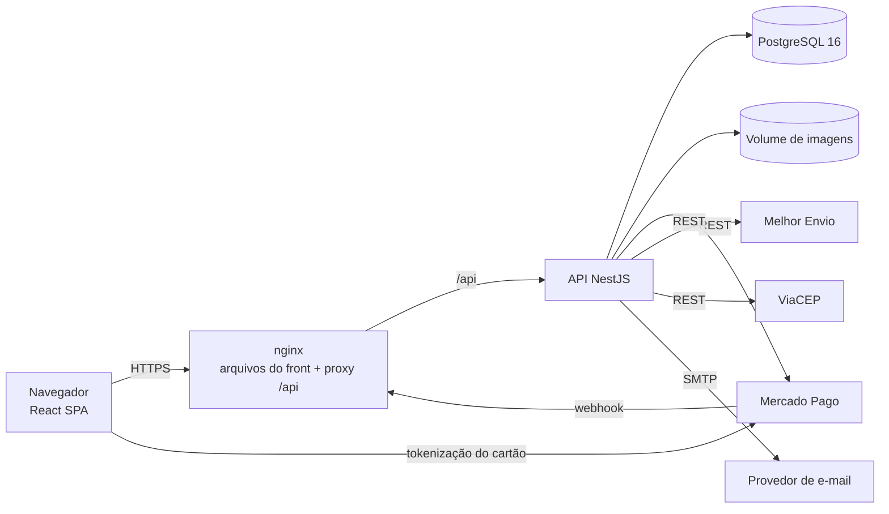

# 02 — Arquitetura

## 1. Estilo

**Monólito modular** em dois aplicativos que andam juntos no mesmo repositório (monorepo com *npm workspaces*):

- `apps/web` — SPA em **React + TypeScript** (Vite). Só apresentação: nenhuma regra de preço, estoque ou frete roda no navegador.
- `apps/api` — API REST em **Node.js + TypeScript (NestJS)**. Concentra todas as regras de negócio, o acesso ao banco e as integrações.

Microsserviços não se justificam para um vendedor, ~2 mil pedidos/mês e um time pequeno (ADR-001). Os módulos do NestJS já dão as fronteiras internas; se um dia for preciso separar (por exemplo, pagamentos), o módulo vira serviço sem reescrever o resto.



Front e API são servidos **na mesma origem** (o nginx entrega o front e repassa `/api` para a API). Com isso o cookie de sessão é *first-party*, não há CORS em produção e a CSP fica simples.

## 2. Camadas dentro da API

```
Controller (HTTP, validação com zod, cookies)   →  apps/api/src/<modulo>/*.controller.ts
Service (casos de uso, transações)              →  apps/api/src/<modulo>/*.service.ts
Domínio (regras puras, sem I/O)                 →  apps/api/src/dominio/*.ts
Infraestrutura (Drizzle, HTTP, SMTP, disco)     →  apps/api/src/infra/*, apps/api/src/db/*
```

Regras que não dependem de banco (CPF, transições de status, totais, parcelas, assinatura do webhook, TOTP) ficam em `dominio/` como funções puras e têm testes unitários. Integrações externas ficam atrás de interfaces (`GatewayPagamento`, `ProvedorFrete`, `ServicoCep`, `EnvioEmail`) injetadas pelo NestJS — nos testes entram implementações falsas.

## 3. Stack

| Item | Escolha | Versão |
|---|---|---|
| Runtime | Node.js LTS | 22 |
| Linguagem | TypeScript (modo `strict`) | 5.9 |
| API | NestJS (plataforma Express) | 11 |
| Acesso a dados | Drizzle ORM + `pg` (node-postgres) | 0.45 / 8 |
| Banco | PostgreSQL com `unaccent` e `pg_trgm` | 16 |
| Validação | zod (mesmos esquemas no controller) | 4 |
| Logs | Pino (`nestjs-pino`), JSON com `reqId` | 10 |
| Segurança HTTP | helmet, `@nestjs/throttler`, cookie-parser | — |
| Documentação da API | OpenAPI/Swagger (`@nestjs/swagger`) em `/api/docs` (só fora de produção) | 11 |
| Front | React + React Router + TanStack Query | 19 / 7 / 5 |
| Build do front | Vite | 7 |
| Pagamento no navegador | `@mercadopago/sdk-react` (Card Payment Brick) | 1 |
| Testes da API | Jest + ts-jest + supertest, PostgreSQL real | 30 |
| Testes do front | Vitest + Testing Library | 3 |
| Contêineres | Docker (multi-stage) + docker compose; nginx no front | — |
| CI/CD | GitHub Actions + GitHub Container Registry (GHCR) | — |

## 4. Estrutura de pastas

```
PortalVendasNode/
├─ apps/
│  ├─ api/               NestJS: src/{dominio,db,infra,auth,catalogo,carrinho,contas,frete,pedidos,pagamentos,admin,saude}
│  │  └─ test/           testes de integração (supertest + PostgreSQL)
│  └─ web/               React: src/{api,componentes,paginas,admin,estilos}
├─ db/
│  ├─ migrations/        V001__*.sql, V002__*.sql … (aplicados em ordem, registrados em schema_versao)
│  └─ seed/              dados de exemplo (só desenvolvimento/homologação)
├─ deploy/               nginx.conf, scripts de backup
├─ .github/workflows/    ci.yml (CI) e cd.yml (entrega)
├─ docker-compose.yml    ambiente local completo
├─ docker-compose.prod.yml
└─ docs/
```

## 5. Autenticação e autorização (ADR-004)

- **Senha:** scrypt (`crypto.scrypt`, N=2¹⁴, r=8, p=1, sal de 16 bytes), comparação em tempo constante. Bloqueio de 15 min após 5 falhas.
- **Sessão:** cookie `pv_sessao` *HttpOnly*, *Secure* (produção), *SameSite=Lax*, contendo `{uid, mfa, carimbo, exp}` assinado com HMAC-SHA256 (`SESSAO_SEGREDO`). A cada requisição a API carrega o usuário e compara o `carimbo_seguranca`: trocar a senha, zerar o 2FA ou anonimizar a conta derruba todas as sessões na hora.
- **CSRF:** *double submit*. A API grava o cookie legível `pv_csrf`; o front devolve o valor no cabeçalho `X-CSRF-Token` em todo POST/PUT/PATCH/DELETE. O webhook é a única rota isenta (é autenticada pela assinatura do Mercado Pago).
- **Perfis:** `1 Cliente`, `2 Administrador`. Guard `@Perfil('admin')` exige perfil 2 **e** `mfa = true` na sessão.
- **2FA do administrador:** TOTP (RFC 6238, 6 dígitos, 30 s, janela ±1), implementado com `crypto` (sem dependência). O segredo é gravado cifrado com AES-256-GCM (`CHAVE_CIFRAGEM`). No primeiro login o painel mostra o QR Code (`otpauth://`) e a chave para o autenticador.
- **Administradores** são criados pela linha de comando: `npm run criar-admin -w apps/api -- email "Nome"`.

## 6. Integrações

| Serviço | Uso | Contrato |
|---|---|---|
| Mercado Pago | Pix, boleto (`bolbradesco`) e cartão | `POST /v1/payments` com `X-Idempotency-Key`; `GET /v1/payments/{id}`; `POST /v1/payments/{id}/refunds`. Webhook `POST /api/webhooks/mercadopago`, assinatura `x-signature` = HMAC-SHA256 de `id:{data.id};request-id:{x-request-id};ts:{ts};` |
| Melhor Envio | Cotação de frete | `POST /api/v2/me/shipment/calculate` com `from`, `to` e `products` (peso, medidas, valor declarado). Timeout 5 s; falha → tabela `faixa_frete` |
| ViaCEP | Endereço pelo CEP | `GET https://viacep.com.br/ws/{cep}/json/` com cache em memória de 24 h |
| SMTP | E-mails transacionais | nodemailer; com `EMAIL_PASTA` definido, grava `.eml` em disco |

O webhook nunca é tomado como verdade: a API sempre consulta o pagamento no Mercado Pago antes de mudar status (RN08). Um **job de manutenção** dentro da API roda a cada 5 min — expira pedidos, concilia pagamentos pendentes e limpa dados vencidos. Ele usa `pg_try_advisory_lock`, então com várias réplicas da API só uma executa por vez (ADR-007).

## 7. Erros, logs e observabilidade

- Filtro global de exceções: erros de negócio viram `4xx` com `{ mensagem }` em português; qualquer outro erro vira `500` com `{ mensagem: "Erro inesperado", reqId }` e o detalhe vai só para o log.
- Pino em JSON com `reqId` (aceita `X-Request-Id` do nginx), *redact* de `senha`, `cpf`, `telefone`, `authorization`, `cookie`.
- `GET /api/health` → `200 {status:"ok"}` com o banco respondendo, `503` se não. Usado pelo `HEALTHCHECK` do Docker, pelo pipeline e pelo monitor externo.

## 8. Segurança desde o design (OWASP Top 10)

| Risco | Medida |
|---|---|
| A01 Controle de acesso | Toda consulta de pedido/endereço filtra por `usuario_id` da sessão (IDOR → 404); guard de perfil + 2FA no admin |
| A02 Criptografia | HTTPS + HSTS no proxy; scrypt; AES-256-GCM para o segredo TOTP; tokens de e-mail guardados só como SHA-256 |
| A03 Injeção | Drizzle com parâmetros; zod valida todo corpo, query e parâmetro; React escapa o HTML |
| A04 Design inseguro | Preço, frete e total sempre recalculados no servidor; idempotência no pedido e no pagamento; reserva de estoque atômica |
| A05 Configuração | helmet; CSP no nginx; Swagger desligado em produção; contêiner sem root |
| A06 Componentes | `npm audit` e Dependabot no pipeline; versões fixadas no `package-lock.json` |
| A07 Autenticação | bloqueio por falhas, rate limit em login/cadastro, 2FA no admin, mensagens que não revelam se o e-mail existe |
| A08 Integridade | Assinatura HMAC do webhook; imagens Docker construídas só pelo pipeline |
| A09 Logs | Log estruturado de login, mudança de status, webhook; sem dados pessoais |
| A10 SSRF | A API só chama URLs fixas de configuração; nada vindo do usuário vira URL |

## 9. Atendimento aos requisitos não funcionais

| RNF | Decisão |
|---|---|
| RNF01 Desempenho | Índices de vitrine, busca com `pg_trgm` sobre `unaccent`, paginação no banco, `Cache-Control` nos arquivos do front e nas imagens |
| RNF02–RNF06 Segurança | Seções 5 e 8 |
| RNF07 LGPD | Exportação em JSON e anonimização (`/api/conta/dados`), CPF/telefone mascarados nas respostas e no log |
| RNF08 Auditoria | Tabela `pedido_historico` e colunas `criado_por`/`alterado_por` |
| RNF09 Observabilidade | Seção 7 |
| RNF10 Disponibilidade | `restart: unless-stopped`, health check, backup diário + WAL (ver implantação) |
| RNF11–RNF12 Usabilidade/acessibilidade | Layout responsivo próprio, checkout em 3 etapas, foco visível, contraste AA |
| RNF13 Manutenibilidade | Regras puras em `dominio/`, testes unitários e de integração no CI |

## 10. ADRs

| ADR | Decisão |
|---|---|
| [001](adr/001-monolito-modular.md) | Monólito modular: SPA React + API NestJS no mesmo repositório |
| [002](adr/002-nestjs-postgres.md) | NestJS + PostgreSQL |
| [003](adr/003-drizzle-scripts-sql.md) | Drizzle ORM com esquema por scripts SQL versionados |
| [004](adr/004-sessao-cookie.md) | Sessão em cookie assinado + CSRF *double submit* + TOTP no admin |
| [005](adr/005-tokenizacao-cartao.md) | Cartão tokenizado no navegador (PCI SAQ A) |
| [006](adr/006-frete-contingencia.md) | Melhor Envio com contingência por faixa de CEP |
| [007](adr/007-job-advisory-lock.md) | Job de manutenção dentro da API com *advisory lock* |
| [008](adr/008-docker-github-actions.md) | Docker + GitHub Actions + GHCR |
