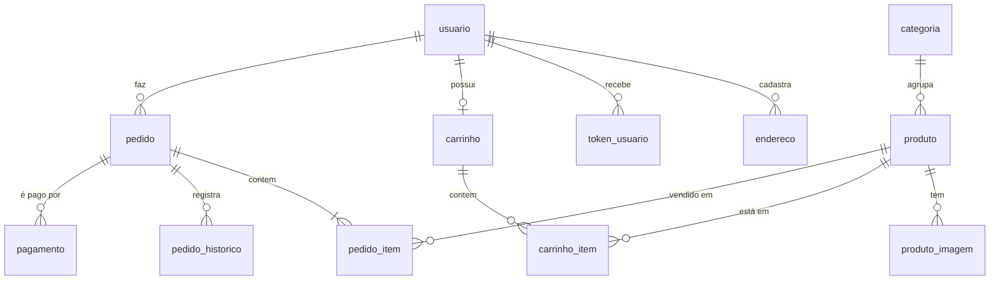

# 03 — Banco de dados (PostgreSQL 16)

## 1. Modelo conceitual



Tabelas independentes: `faixa_frete` (contingência de frete), `configuracao` (chave/valor editável no admin), `notificacao_gateway` (log de webhooks) e `schema_versao` (controle de scripts, criada pelo migrador).

## 2. Convenções

- Tabelas no singular e em `snake_case`; PK `id` (`integer GENERATED ALWAYS AS IDENTITY`, `bigint` nas tabelas de log); FK `<tabela>_id`.
- Datas em `timestamptz` (gravadas em UTC); dinheiro em `numeric(12,2)` — na API trafegam como string e viram centavos inteiros nos cálculos, nunca `float`.
- Constraints nomeadas `pk_`, `fk_`, `uq_`, `ck_`, `ix_`. Regras de integridade ficam no banco também: estoque nunca negativo, reserva ≤ estoque, total do pedido = subtotal + frete − desconto, total do item = preço × quantidade, quantidade no carrinho 1–10, parcelas 1–12, CEP com 8 dígitos, UF válida.
- Colunas de auditoria: `criado_em`, `alterado_em` em todas; `criado_por`/`alterado_por` em `produto` e `configuracao`; histórico completo de status em `pedido_historico`.

## 3. Modelo lógico — destaques

| Tabela | Destaques |
|---|---|
| `produto` | `estoque` e `estoque_reservado` (RN02/RN03); `preco_de` opcional (> `preco`); peso e medidas obrigatórios (RF19) |
| `usuario` | e-mail único em minúsculas; CPF único parcial (`WHERE cpf IS NOT NULL`); `carimbo_seguranca` (revoga sessões); `totp_segredo_cifrado` + `totp_ultimo_passo` (bloqueia reuso do código) |
| `token_usuario` | só o SHA-256 do token; validade e uso único |
| `endereco` | no máximo um `padrao` por usuário (índice único parcial) |
| `carrinho` | `token` (cookie do visitante) ou `usuario_id` (único parcial) |
| `pedido` | endereço copiado; `chave_idempotencia` única; `versao` para concorrência otimista; numeração começa em 1001 |
| `pagamento` | `gateway_id` único parcial; `chave_idempotencia` única; só bandeira e últimos 4 dígitos |
| `notificacao_gateway` | `request_id` único parcial (deduplicação do webhook) |

## 4. Índices e justificativa

| Índice | Consulta atendida |
|---|---|
| `ix_produto_vitrine (categoria_id, preco) WHERE ativo` | Vitrine com filtro de categoria e ordenação/limite de preço |
| `ix_produto_recentes (criado_em DESC) WHERE ativo` | Vitrine padrão "mais recentes" |
| `ix_produto_busca` GIN trigram sobre `f_sem_acento(nome ‖ descricao)` | Busca `LIKE '%termo%'` sem acento/maiúsculas (RF02) sem varrer a tabela |
| `ix_produto_imagem_produto_id (produto_id, ordem)` | Galeria e foto de capa |
| `ix_pedido_usuario_id_criado_em` | Meus pedidos |
| `ix_pedido_status_criado_em`, `ix_pedido_criado_em` | Admin por status/período e painel de vendas |
| `ix_pedido_expiracao (expira_em) WHERE status IN (1,2)` | Job de expiração |
| `ix_pagamento_pendentes (criado_em) WHERE status IN (1,2)` | Job de conciliação |
| `ix_carrinho_anonimo_atualizado_em WHERE usuario_id IS NULL` | Limpeza de carrinhos abandonados |
| um índice por FK restante | Joins e `ON DELETE CASCADE` sem varredura |

`f_sem_acento(text)` é um invólucro `IMMUTABLE` de `unaccent` + `lower`, necessário para indexar a expressão.

## 5. Reserva de estoque (RN02/RN03)

A reserva é um único `UPDATE` condicional por item, dentro da transação do pedido:

```sql
UPDATE produto SET estoque_reservado = estoque_reservado + $qtd
 WHERE id = $id AND ativo AND estoque - estoque_reservado >= $qtd
RETURNING id;
```

Se alguma linha não volta, a transação é desfeita e o cliente vê quais itens ficaram indisponíveis. Na aprovação do pagamento: `estoque -= qtd, estoque_reservado -= qtd`. No cancelamento/expiração: `estoque_reservado -= qtd`.

## 6. LGPD

| Dado pessoal | Tabela | Tratamento |
|---|---|---|
| Nome, e-mail, CPF, telefone | `usuario` | CPF/telefone mascarados nas respostas da API e removidos dos logs; anonimização troca por valores neutros, zera CPF/telefone, remove endereços e muda o carimbo |
| Endereço | `endereco`, `pedido` (cópia) | O endereço do pedido fica por obrigação fiscal (5 anos); rotina de retenção no backlog |
| Cartão | `pagamento` | Só bandeira e últimos 4 dígitos |

Retenção automática (job): carrinhos anônimos sem uso há 30 dias, tokens vencidos há 7 dias e notificações de webhook com mais de 90 dias são apagados.

## 7. Migrações, seed e usuários do banco

- `npm run db:migrar -w apps/api` aplica, em ordem, os `db/migrations/V*.sql` ainda não registrados em `schema_versao`, cada um em transação. `-- --listar` só mostra os pendentes; `-- --seed` também roda `db/seed/S*.sql` e copia as ilustrações para `IMAGENS_DIR` (nunca em produção).
- Reverter: scripts `db/rollback/R00N__*.sql` quando o V00N for reversível; senão, restaurar o backup feito antes do deploy.
- Em produção a API usa um papel só com DML; as migrações rodam com o papel dono do esquema:

```sql
CREATE ROLE portal_app LOGIN PASSWORD '<senha forte>';
GRANT CONNECT ON DATABASE portalvendas TO portal_app;
GRANT USAGE ON SCHEMA public TO portal_app;
GRANT SELECT, INSERT, UPDATE, DELETE ON ALL TABLES IN SCHEMA public TO portal_app;
ALTER DEFAULT PRIVILEGES IN SCHEMA public GRANT SELECT, INSERT, UPDATE, DELETE ON TABLES TO portal_app;
```

## 8. Backup e restore

- **Diário:** `pg_dump -Fc` (contêiner `backup` do `docker-compose.prod.yml`, 02:00, retenção de 14 dias) para um volume e cópia externa.
- **Ponto no tempo (recomendado em produção):** banco gerenciado (Azure Database for PostgreSQL, Amazon RDS, Cloud SQL) com PITR de 7 dias, ou arquivamento de WAL.
- **Restore:** `pg_restore --clean --if-exists -d portalvendas backup.dump`. Ensaiar em homologação antes do go-live.
